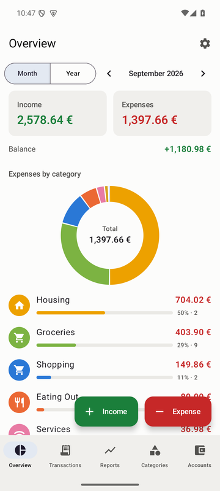
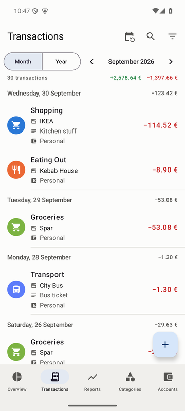
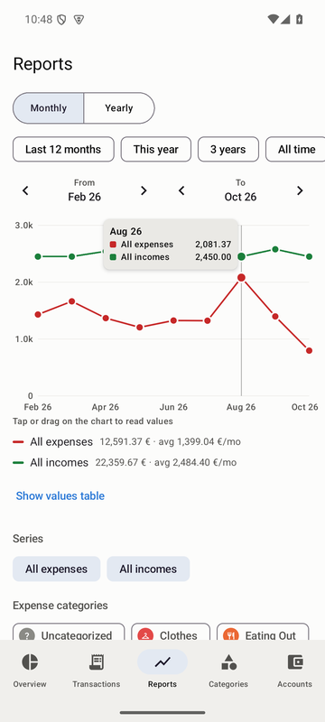
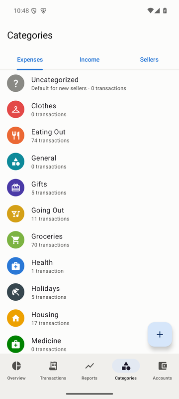
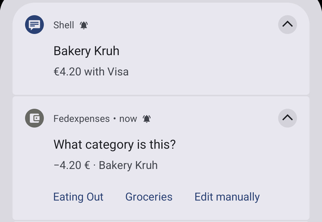

# Fedexpenses

An Android expense tracker that records your card payments for you. When Google Wallet (or your bank app) shows a payment notification, Fedexpenses reads it, saves the transaction immediately, and asks you for a category with one tap. Next time you pay at the same place, it already knows.

Everything stays on your phone: the app has **no internet permission**. Backups go only where you choose to put them.

<p>
  
  
  
  
</p>
<p>
  
</p>

## Features

- **Automatic payment detection** from Google Wallet, or any app that shows payment notifications (configurable with regular expressions).
- **Category learning**: seller rules remember which category each shop belongs to. Unknown sellers get a notification with quick category buttons.
- **Manual entries** for expenses and income, with date, category, account, seller and note.
- **Repeating payments**: weekly, monthly or yearly, created automatically at the start of each day they're due.
- **Overview** of income, expenses and balance per month or year, with a breakdown by category.
- **Transactions** list with search and filters; expenses in red, income in green.
- **Reports**: plot any categories, or all expenses and all income, over any range of months or years.
- **Categories** with your own names, icons and colors (16 presets or any color); several **accounts**.
- **Backups** to Google Drive or any folder, plus CSV import and export.
- Light and dark theme, with a choice of color palettes, your wallpaper colors (Android 12+) or any custom color, and a background that matches the palette, stays neutral, or uses its own color (Settings → Color palette / Background); works with large font and display sizes.

## Installing

1. On your phone, open the [latest release](https://github.com/FAOlivieri/Fedexpenses/releases/latest) and download `Fedexpenses-x.y.z-release.apk`.
2. Open the downloaded file. Android will ask a couple of things because the app doesn't come from the Play Store:
   - **"For your security, your phone is not allowed to install unknown apps from this source"**: tap **Settings**, turn on **Allow from this source** for your browser or file manager, then go back.
   - **Play Protect: "Unsafe app blocked"** or **"App scan recommended"**: tap **More details → Install anyway**. If asked whether to send the app for scanning, you can choose either; it doesn't change anything here. Play Protect flags apps that read notifications and aren't from the Play Store, which is exactly what this app does. It stays active for all your other apps.
3. Open **Fedexpenses**.

**Updating:** download the new APK from Releases and install it over the old one. Your data stays.

## First-time setup

Open **Settings** (gear icon on the Overview screen). The *Payment detection* section shows three things to enable, each with a button:

### 1. Notification access

Needed to read payment notifications. Tap **Grant**, find Fedexpenses in the list and turn it on.

If Android shows **"Restricted setting"** and won't let you turn it on, that's Android 13+ protecting you from apps installed from a file. To allow it for Fedexpenses only:

1. Go to **Settings → Apps → Fedexpenses** (or long-press the app icon → **App info**).
2. Tap the **⋮** menu in the top-right corner and choose **Allow restricted settings**, then confirm with your PIN or fingerprint.
   This menu item only appears *after* you've tried to enable notification access once and got blocked.
3. Go back to Fedexpenses and tap **Grant** again. It will work now.

### 2. Show notifications

So the app can tell you about detected payments and ask for categories. Tap **Allow**.

### 3. Background activity: Unrestricted

So Android doesn't put the app to sleep. Tap **Allow** and confirm. The app doesn't run anything in the background on its own; Android simply hands it each notification as it arrives, so this costs no battery. Some phone brands need an extra step:

- **Samsung**: Settings → Battery → Background usage limits: make sure Fedexpenses is **not** in *Sleeping apps* or *Deep sleeping apps*.
- **Xiaomi / Redmi / POCO**: App info → **Autostart** on, and Battery saver → **No restrictions**.
- **Huawei / Honor**: Settings → Battery → App launch → Fedexpenses → **Manage manually**, with all switches on.
- **OnePlus / OPPO / Realme**: App info → Battery → **Allow background activity**.

Once access is granted, detection keeps working after you swipe the app away from recent apps and after a restart, without opening the app. The only exception is **Force stop** in App info, which disables the app until you open it again.

## Using the app

### Detected payments

When Google Wallet reports a payment, the transaction is saved straight away, with the shop in the **Seller** field.

- **Seller seen before**: it gets that seller's category, and a "Transaction detected" notification lets you **Edit manually** if needed.
- **New seller**: it's saved as *Uncategorized* and the notification asks **"What category is this?"**, with buttons for your two most used categories and **Edit manually**. Tap a button and you're done. From then on, that seller gets that category automatically.

### Seller rules

**Categories → Sellers** lists the rules that decide each detected payment's category. They're created automatically as you categorize payments, and you can edit them or add your own:

- **Match**: *Exact* seller name, *Contains* a word or phrase (e.g. `lidl` matches "LIDL Ljubljana 123"), or a *Regex*. None of them care about upper/lower case.
- **Category**: *Always this category*, or *Last matched*, meaning the category you last gave a payment from that seller.
- **Note** (optional): every detected payment the rule matches gets this note, for example "Lunch" for your canteen.
- **Order**: rules are tried from the top and the first match wins. Drag the ≡ handle to reorder.
- The editor shows which past payments a rule applies to, and can recategorize them in one go.

### Repeating payments

When adding or editing a transaction, set **Repeat** to weekly, monthly or yearly, optionally with an end date. Each repeat is added automatically at the start of its day.

- **Month ends**: a payment on the 31st falls on the last day of shorter months.
- **Editing one payment** of a series asks whether the change applies to *only this one* or *this and the following ones*.
- **All series**: tap the ⟳ icon on the Transactions screen to see each one with its next date, or stop one.

### Watching other apps (e.g. your bank)

**Settings → Watched apps → Add app to watch.** Pick the app, then describe its notifications with [regular expressions](https://regexone.com/). Each app has two sections, which you switch on and off separately:

- **Expenses**: patterns for money going out, recorded as expenses.
- **Income**: patterns for money coming in, recorded as income.

Each section holds one or more patterns, one per line, and the first one that matches is used. Income patterns are tried before expense patterns, so a catch-all expense pattern (like the Google Wallet one) can't swallow incoming payments. Each pattern is matched against the notification's **title, a line break, then its text**, and must capture:

- `(?<amount>…)`: the amount, e.g. `12,50 €`, `€12.50`, or `1.234,56`.
- `(?<merchant>…)`: optional, the seller. Without it, the notification title is used.

Example for a bank whose notifications say *"Card payment of 23,40 EUR at SPAR LJUBLJANA"* and *"Received 1.500,00 EUR from ACME d.o.o."*:

```
Expenses:  payment of (?<amount>[\d.,]+) EUR at (?<merchant>.+)
Income:    Received (?<amount>[\d.,]+) EUR from (?<merchant>.+)
```

The editor lists recent notifications from that app and shows live whether your pattern matches each one, and what it would record. Notifications are collected even while the app's switch is off, so you can add an app first and write its patterns once a few notifications have arrived. A notification that arrived before your pattern matched it can be recorded with **Process now**.

> **Tip:** if two apps report the same payment (e.g. Google Wallet *and* your bank), watch only one of them, or you'll get it twice.

### Android 15 and hidden notifications

Android 15 and newer hide notifications that *look like* they contain a one-time code from apps like this one, and no permission an app can get changes that. A standalone 4-digit number, such as a card ending in `•• 1234`, can trigger it. When that happens, Fedexpenses can't read the amount. It shows **"Payment detected: Android hid the details"** instead; tap it to add the expense with the time already filled in.

## Backup, import and export

All in **Settings**:

- **Android backup**: Android automatically backs up the app's data to your Google account and restores it when you reinstall or move to a new phone.
- **Backup file**: tap **Choose backup file** and pick a location, for example a folder in **Google Drive**. The app rewrites that file every day and whenever you tap **Back up now**.
- **Restore from backup file**: replaces everything in the app with the backup's contents: transactions, categories, accounts, seller rules, watched apps and repeating payments.
- **Import CSV / Export CSV**: one transaction per line:

  ```
  Date, Category, Amount, Note, Account, Seller
  10/5/2026, Services, -24.99, Internet + phone, Personal, Telekom
  10/1/2026, Salary, 2450.00, Monthly salary, Bank, ACME d.o.o.
  ```

  - **Dates** are `month/day/year`, and **negative amounts** are expenses.
  - **Seller** is optional, so files with only the first five columns work too.
  - **Missing categories and accounts** are created automatically, and importing the same file twice doesn't duplicate anything.
  - [`sample-transactions.csv`](sample-transactions.csv) is a complete example you can import to try the app.

## Building from source

Requirements: **JDK 17** and the **Android SDK** (platform 35). Android Studio includes both.

```sh
./gradlew assembleRelease      # APK in app/build/outputs/apk/release/
./gradlew installRelease       # install on a phone connected with USB debugging
./gradlew testDebugUnitTest    # unit tests
```

On Windows Command Prompt use `gradlew` instead of `./gradlew`, after `set JAVA_HOME=<path to JDK 17>`.

Without a signing key configured, release builds are signed with your local debug key. That's fine for your own phone, but it won't install over the official release (Android only accepts updates signed with the same key). In that case uninstall the app first, after making a backup.

### Signing and publishing releases (maintainers)

The release key is never committed. `local.properties` (git-ignored) points to it:

```properties
fedexpenses.storeFile=C\:/path/to/fedexpenses-release.jks
fedexpenses.storePassword=…
fedexpenses.keyAlias=fedexpenses
fedexpenses.keyPassword=…
```

The same values can come from the environment variables `FEDEXPENSES_STOREFILE`, `FEDEXPENSES_STOREPASSWORD`, `FEDEXPENSES_KEYALIAS` and `FEDEXPENSES_KEYPASSWORD`.

Keep a backup of the keystore file and its password. If the key is lost, nobody can install an update over the existing app any more.

To publish a release:

1. Increase `versionCode` and `versionName` in `app/build.gradle.kts`.
2. Run `./gradlew assembleRelease`.
3. Run `gh release create vX.Y.Z app/build/outputs/apk/release/Fedexpenses-X.Y.Z-release.apk --generate-notes`.

### Project layout

- `data/`: Room database, CSV/JSON import-export, seller rules, repeating payments.
- `notify/`: notification listener, notification parsing, the app's own notifications.
- `ui/`: Jetpack Compose screens.
- `work/`: nightly job for repeating payments, backup and keep-alive jobs.
